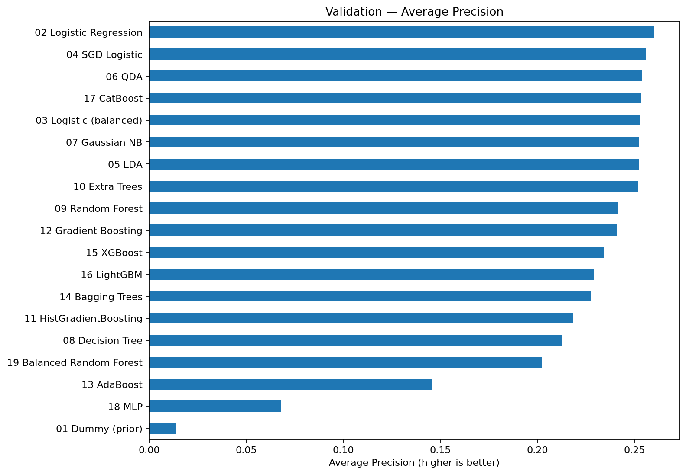

# Credit Risk Analytics — Individual PD Modeling & Forecasting

An end-to-end **credit risk analytics portfolio project** using **synthetic loan data**. The main task is estimating each loan's **probability of entering default in the next month**; aggregate default-rate forecasting is a separate, optional exercise.

**Stack:** Python · Pandas · PostgreSQL (optional) · scikit-learn · XGBoost · LightGBM · CatBoost · statsmodels

> **Disclaimer:** All loan records are synthetic and the results are illustrative. This project is not suitable for real lending decisions without extensive validation, monitoring, and governance.

## Project workflow

1. **Exploratory analysis:** analyze the portfolio, ratings, loan amounts, payment delays, and default incidence.
2. **Target design:** for a loan observed at month *t*, predict whether it enters default in month *t+1*; only consecutive observed months are used.
3. **Model benchmark:** compare 19 classifier configurations using chronological training, validation, and holdout test periods.
4. **Evaluation:** Average Precision (AP), ROC-AUC, Brier score, and Precision/Recall among the top 10% riskiest loan-month observations.
5. **Optional forecasting:** predict the aggregate monthly new-default rate using Holt exponential smoothing.

## Results

**Validation** selected **Logistic Regression** by the highest Average Precision (AP = **0.2600**). The class imbalance makes AP more informative than accuracy alone. Results are from the provided synthetic dataset and the saved evaluation runs.

| Metric | Logistic Regression — holdout |
|---|---:|
| Average Precision (AP) | **0.2214** |
| ROC-AUC | **0.9553** |
| Brier score | **0.0132** |
| Precision@10% | **12.80%** |
| Recall@10% | **83.49%** |

The top 10% refers to **loan-month observations**, not 10% of distinct borrowers. Selecting a model based on holdout performance would introduce test-set selection bias; therefore the model was selected on validation data.



Other models can lead in individual metrics. See [full validation results](results/pd_validation_results.csv) and [holdout results](results/pd_holdout_results.csv).

## Repository structure

```text
credit-risk-pd-forecasting/
├── notebooks/
│   ├── 01_credit_risk_eda.ipynb
│   ├── 02_aggregate_forecasting.ipynb
│   └── 03_pd_modelling.ipynb
├── data/
│   ├── raw/                 # original synthetic CSV files
│   └── processed/           # labeled loan-month dataset
├── results/                 # benchmark metrics and loan-month PD estimates
├── assets/                  # README chart previews
├── sql/schema.sql
├── main.py                  # optional PostgreSQL connection check
├── .env.example
├── .gitignore
└── requirements.txt
```

## Quick start (no database required)

```bash
python3 -m venv .venv
source .venv/bin/activate
pip install -r requirements.txt
jupyter lab
```

Run the notebooks in this order:

- `notebooks/01_credit_risk_eda.ipynb`: explores raw synthetic CSVs by default and generates `data/processed/pd_dataset.csv`.
- `notebooks/03_pd_modelling.ipynb`: benchmarks classifiers, evaluates the holdout, and writes metrics/predictions to `results/`.
- `notebooks/02_aggregate_forecasting.ipynb`: optional aggregate series forecast.

CSV loading is automatic when no database credentials are set. A precomputed `data/processed/pd_dataset.csv` is also bundled so model training can run independently.

## Optional PostgreSQL setup

Create a database called `credit_risk`, then from the repository root:

```bash
psql -h localhost -U credit_user -d credit_risk -f sql/schema.sql
psql -h localhost -U credit_user -d credit_risk
```

In the interactive `psql` terminal, import both CSVs **in this order**:

```sql
\copy raw.contracts FROM 'data/raw/contratos.csv' WITH (FORMAT csv, HEADER true);
\copy raw.monthly_performance FROM 'data/raw/desempenho_mensal.csv' WITH (FORMAT csv, HEADER true);
```

The CSV headers use Portuguese names; `\copy` maps data by **column position**, which matches the SQL tables. Import into empty tables; running `\copy` repeatedly will encounter primary-key conflicts.

Make a local `.env` file from `.env.example` and set the actual database credentials. **Do not commit `.env` or passwords.** When all connection variables are set, the first two notebooks read the `raw` schema from PostgreSQL rather than CSVs. You can verify the database connection using `python main.py`.

## Modeling choices and limitations

- The event is **next-month first default** in the synthetic data. This is **not a 12-month PD**.
- One contract can contribute multiple monthly observations. Chronological splitting tests later observations, not unseen borrowers.
- `days_past_due` strongly predicts default because the synthetic event definition is linked to reaching 90 days past due. Reported metrics may be optimistic compared with real-world lending data.
- The positive class is rare (about **1.3%**). We compare predicted probabilities using the Brier score, but additional calibration checks and out-of-time validation would be needed for real financial use.
- The raw monthly defaults are *new events*, not the stock of all delinquent loans.
- Individual PD modeling and aggregate forecasting answer **different business questions** and should not be conflated.

## Data privacy

The repository includes **only generated synthetic data**. No bank customer records or credentials are required.
